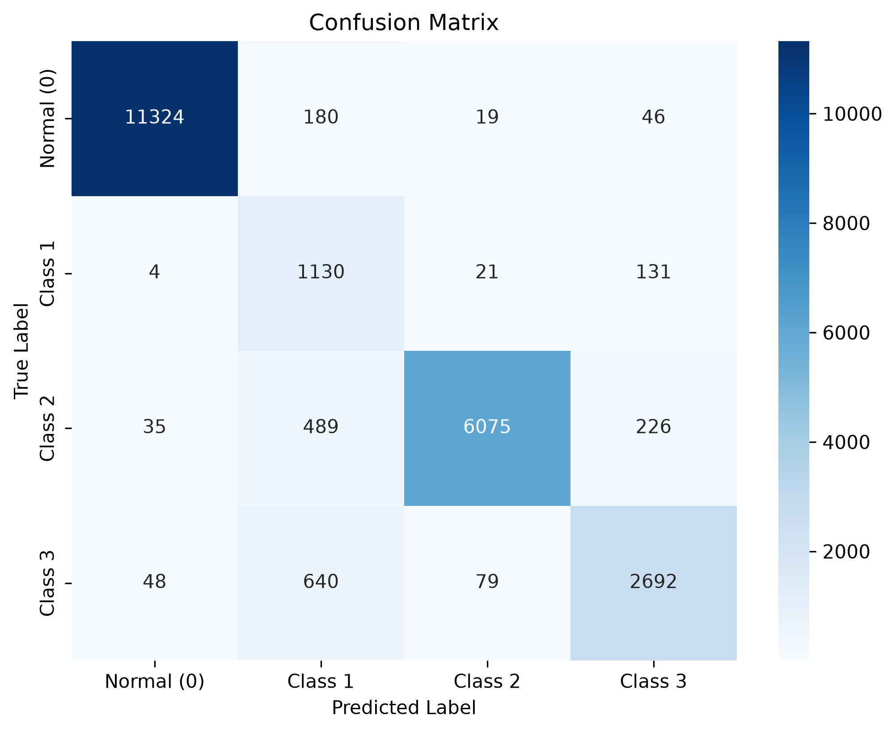

# Heart_Arrhythmia_Detection
# Heart Arrhythmia Detection (ECG)

A 1D Convolutional Neural Network (CNN) built with PyTorch to classify individual heartbeats into four arrhythmia categories. The focus of this project is evaluating medical data honestly by using class weighting to handle severe class imbalance.

## Dataset
The model is trained on the Hybrid Single Lead ECG Dataset. 
- Input: 160-timestep 1D ECG signals.
- Total Samples: 115,693 heartbeats.
- Classes: 4 (Normal, Class 1, Class 2, Class 3).
- Challenge: The dataset is highly imbalanced. The majority class (Normal) contains ~57k samples, while the most critical class (Class 1) contains only ~6k.

## Model Architecture
A custom 1D CNN implemented in PyTorch (`src/model.py`):
- Three Conv1D blocks (32, 64, 128 filters) with Batch Normalization and ReLU activation.
- Max Pooling and Adaptive Average Pooling.
- Dropout (0.2 to 0.3) to prevent overfitting.
- Fully Connected layer outputting 4 classes.
- Loss Function: Cross-Entropy with balanced class weights. This forces the model to pay attention to the rare, critical classes rather than just predicting the majority class.

## Results
The model was trained for 10 epochs. In medical contexts, accuracy is misleading because the majority class dominates. We report Precision, Recall, and the Macro F1-Score.

| Class | Precision | Recall | F1-Score | Support |
| :--- | :--- | :--- | :--- | :--- |
| Normal (0) | 0.99 | 0.98 | 0.99 | 11569 |
| Class 1 | 0.46 | 0.88 | 0.61 | 1286 |
| Class 2 | 0.98 | 0.89 | 0.93 | 6825 |
| Class 3 | 0.87 | 0.78 | 0.82 | 3459 |
| **Macro Avg** | **0.83** | **0.88** | **0.84** | **23139** |

- Overall Accuracy: 92%
- Macro F1-Score: 0.84
- Recall on the critical Class 1: 88%

### Confusion Matrix


## Setup and Usage

1. Clone the repository:
   ```bash
   git clone https://github.com/YOUR_USERNAME/ecg-arrhythmia-detection.git
   cd ecg-arrhythmia-detection
   python -m venv .venv
# On Windows:
.\.venv\Scripts\Activate.ps1
# On Mac/Linux:
source .venv/bin/activate
pip install -r requirements.txt
# Download the data
Download balanced_augmented_ecg_data.csv from Kaggle and place it in the data/ folder.
# Train the model
cd src
python train.py
# Evaluate the model:
python evaluate.py
# NOTE
This model is for educational and research purposes only. It is not a medical device.

The dataset lacks patient IDs, so the train/test split was done randomly. 
This can lead to optimistic scores because beats from the same patient might appear in both sets.
The model was trained on a CPU; training on a GPU with more epochs would likely improve the results.
